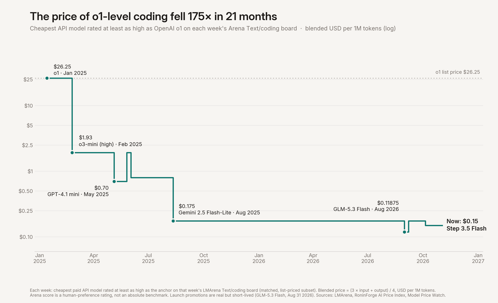

# cheap-intelligence

**Coding intelligence got ~118× cheaper in 30 months.**

From April 2024 to October 2026, the Chatbot Arena *coding* score–price Pareto frontier marched up and left: peak quality rose, and the cost of clearing yesterday’s published score collapsed. The April 2024 coding peak (~**1267** at ~**$15**/MTok blended, GPT-4 Turbo `1106`) is cleared the week of October 26, 2026 by `gpt-oss-20b` at **$0.1275**/MTok standard list price — about **118×** lower for the old score threshold. The low point was August 31, 2026, when `glm-5.3-flash` cleared it at a launch-promotion **$0.11875** (~**126×**); that promotion ended September 9. This repo packages the weekly panels, methods, caveats, exports, and a chaptered movie of that migration.

“Cost of intelligence” is deliberately provocative shorthand, not a claim that Arena is an absolute intelligence meter. The exact factor depends on the benchmark slice, dates, price mix, match coverage, and pricing schedule. The claim is narrower: over 30 months, the list-price cost of exceeding one published human-preference score threshold fell by roughly two orders of magnitude.

## What a Pareto frontier means here

Each week we plot matched models in **(blended $/MTok, Arena Text/coding score)** space. A model is on the **Pareto frontier** if no other matched model that week is both **cheaper (or equal) and higher-scoring (or equal)** with at least one strict inequality — i.e. maximum published score for a given price, and minimum price for a given score. Dominated interior points are ignored in the story charts; only the frontier polyline matters.

**Blended price** = `(3 × input + 1 × output) / 4` USD per 1M tokens (3:1 input-heavy mix).

## Key finding (coding spine)

| Anchor | Published Text/coding score | Cheapest blended $/MTok clearing that score | Models (illustrative) |
|--------|-----------------|--------------------------------------|------------------------|
| **2024-04-01** | ~**1267** | **$15.00** | `gpt-4-1106-preview` |
| **2026-08-31 snapshot** | clears the old bar | **$0.11875** (~**126×**) | `glm-5.3-flash`, launch promotion |
| **2026-10-26 latest week** | clears the old bar | **$0.12750** (~**118×**) | `gpt-oss-20b` (Fireworks); `step-3.5-flash` at $0.15 is ~100×, Claude Haiku 5.5 at $0.20 is ~75×, `glm-5.3-flash` at $0.2375 is ~63× |

Peak *ceiling* also rose: ~1267 → ~1547 weekly maximum priced score (`claude-opus-5.5-high` at $8, week of October 26, 2026, on 2,555 votes), with running-max envelope ~1553. The price of near-peak coding halved in October: `gemini-4-argon-high` scores ~1538 at **$4** (introductory rate through November 30). Gemini 4 Carbon (~1569, #1 on the October 28 board) was announced the same day at the same $4 blended introductory rate but has no list price yet, so it is not plotted. See `data/frontiers/coding/_summary.json` and `media/coding/`.

> **Watch:** [`media/coding/frontier_evolution_chaptered.mp4`](media/coding/frontier_evolution_chaptered.mp4) — nine chapter freezes from the GPT-4-era stub through the ~$0.12 launch-promo tip and Opus 5.5's peak at $8 to Gemini 4 Argon at $4.

## The cost of a fixed amount of intelligence

Take the model that led the coding board at some past date, and ask each week since: *what is the cheapest API model rated at least as high as it, on that week's board?* The answer may be a newer model — that is the point.



OpenAI **o1** topped the Text/coding board in January 2025 at **$26.25**/MTok blended. Six weeks later `o3-mini-high` matched it at $1.93; by August 2025 Gemini 2.5 Flash-Lite did so at $0.175. The week of October 26, 2026 it costs **$0.15** (`step-3.5-flash`) — about **175× cheaper in 21 months**. Nearly all of that fall came in the first seven months; from August 2025 the price of o1-level coding sat at $0.175, apart from GLM-5.3 Flash's one-week $0.119 launch promotion, until Step 3.5 Flash gained a list price in our sources in October 2026.

The factor depends heavily on which past leader you pick, because some leaders were themselves bargains:

| Past board leader | Anchor week | Price then | Cheapest equal-or-better now | Decline |
|-------------------|-------------|-----------|------------------------------|---------|
| `o1-mini` | 2024-09-16 | $1.925 | $0.15 (`step-3.5-flash`) | ~**13×** in 25 months |
| **`o1`** | 2025-01-13 | $26.25 | $0.15 (`step-3.5-flash`) | ~**175×** in 21 months |
| `claude-3-7-sonnet` | 2025-02-24 | $6.00 | $0.1375 (`gpt-5-nano-high`) | ~**44×** in 20 months |
| `chatgpt-4o-latest` (Mar 2025) | 2025-03-31 | $4.375 | $0.15 (`step-3.5-flash`) | ~**29×** in 19 months |

Read the o1 number with care: `o1-mini` sat ~4 rating points below o1 that week (well inside the noise) at under a tenth of the price, so 175× measures the fall from a *flagship's sticker price*, while ~13× measures the fall from the *best deal available* at nearly the same level. Both are true. `o1-preview` and `gpt-4.5-preview` also led the board in this window but have no dated list price in our sources, so they cannot anchor a series.

> **Watch:** [`media/coding/fixed_intelligence.mp4`](media/coding/fixed_intelligence.mp4) (~24s) · all four anchors: [`fixed_intelligence_anchors.png`](media/coding/fixed_intelligence_anchors.png) · data: [`fixed_intelligence_cost.csv`](data/frontiers/coding/fixed_intelligence_cost.csv)

## Current frontier watch — October 28, 2026

These are not forced onto one axis. Text/coding and WebDev are separate Arena boards, and a model is only placed on a board where it has a published rating.

| Model | Independent capability signal | 3:1 blended list price | Status |
|-------|-------------------------------|------------------------|--------|
| **Gemini 4 Carbon** | Text/coding **1569.5**, rank 1 (1,106 votes); WebDev **1768.2**, rank 4 | announced **$4.00** intro, not listed | Announced Oct 28 with limited access; off the price axis until Google lists it |
| **Claude Opus 5.5** | Text/coding **1547.2**, rank 2 (`-high`, 2,555 votes); WebDev **1809.8**, rank 1 (`-max`) | **$8.00** | Top of the priced coding frontier |
| **Gemini 4 Argon** | Text/coding **1538.2**, rank 3; WebDev **1679.2** | **$4.00** intro (**$8.00** from Dec 1) | Released Oct 13; on the frontier, 9 points below Opus 5.5 at half the price |
| **Claude Sonnet 5.5** | Text/coding **1511.9**, rank 14 (`-xhigh`); WebDev **1769.7**, rank 3 | **$4.00** | Released Sep 28; inside the coding frontier (Argon scores higher at the same price) |
| **GLM-5.3 Flash** | Text/coding **1509.2**; WebDev **1606.6** | **$0.2375** | On the frontier; cheapest model above 1500 |
| **Claude Haiku 5.5** | Text/coding **1454.3**, rank 93; WebDev **1588.8** | **$0.20** | Released Oct 7; replaces GPT-6 Luna (now 1436.6 on 19,790 votes) at the $0.20 point |
| **Step 3.5 Flash** | Text/coding **1435.8** | **$0.15** | First list price in our sources Oct 8; cheapest paid model at o1 level |
| **DeepSeek V4.1 Flash 1017** | WebDev **1665.0**, rank 16; no Text/coding score yet | **$0.525** peak / **$0.2625** off-peak | Replaced the 0910 build on Oct 17 at the same price |
| **MiMo v2.6 Pro** | Text/coding **1533.5**, rank 4 (1,091 votes) | no list price found | Excluded from the price axis until Xiaomi publishes an API price we can cite |

All scores are from the October 28 snapshots. The auditable snapshot is [`data/current/current_model_watch.csv`](data/current/current_model_watch.csv). The normalized October 28 WebDev board is [`data/arena/webdev/arena_webdev_latest.csv`](data/arena/webdev/arena_webdev_latest.csv).

## Data sources

1. **LMArena / Chatbot Arena leaderboard** — Hugging Face [`lmarena-ai/leaderboard-dataset`](https://huggingface.co/datasets/lmarena-ai/leaderboard-dataset)
   - Primary spine: subset `text`, category **`coding`**
   - Raw Text is used for longitudinal continuity: the available style-controlled coding series begins in September 2024 and would remove the April anchor
   - Optional: `text` / overall (weekly CSV included; full raw Parquet not shipped)
   - Secondary tip chart: Code Arena WebDev (`webdev` / `overall`) when a Text/coding score is missing
2. **Dated API prices**
   - **RoninForge AI Price Index** — https://roninforge.org/ai-price-index/ / [open data](https://roninforge.org/data/ai-price-index/) (**CC BY 4.0**)
   - **Model Price Watch** — https://modelpricewatch.com (supplement for models not in RoninForge)
3. **Blended price** = `(3*input + output)/4` as above
4. Optional secondary: Code Arena tip visuals for current models without a Text/coding score

Normalized CSVs live under `data/`. Huge raw JSON/Parquet dumps are **not** included; rebuild from upstream if you need them.

## Methods

- **Weekly Mondays.** Arena snapshots and prices are aligned to ISO week starts (Monday). Panel coverage for the coding × price join: **2024-04-01 → 2026-10-26** (123 weeks; no snapshot was published in the week of September 14). Each week uses its last published snapshot and the Monday list price, with one rule for mid-week changes: if a price took effect before the week's snapshot, that price is used (GLM-5.3 Flash's standard rate for week 2026-09-07; the launch prices of Opus 5.5, GPT-6 Sol/Luna and Grok 4.7 for week 2026-09-21, whose snapshot is September 25). Models removed from a vendor's price list leave the panel from the first week whose snapshot follows the removal (Gemini 3.5/3.7 Flash from week 2026-10-05, retired Qwen3 Max/Coder SKUs from week 2026-10-12, DeepSeek V4.1 Flash 0910 from week 2026-10-19). DeepSeek is priced at its peak (standard) rate; off-peak is a 50% discount.
- **Arena name change.** From the October 20, 2026 snapshot, LMArena publishes display names (`Claude Opus 5.5 (High)`) in place of slugs (`claude-opus-5.5-high`). `scripts/update_arena_snapshots.py` maps them back through `data/arena/display_name_map.csv` (409 rows: exact token matches plus 53 hand-checked pairs) so each model keeps one continuous series; ratings for mapped models move a median 0.05 points across the switch. Models first published under a display name keep it.
- **Name matching.** Arena display names ↔ price catalog IDs via normalization + a checked crosswalk (`data/model_name_crosswalk.csv`, `data/frontiers/arena_price_name_matches.csv`). No invented scores or prices — unmatched models are listed, not guessed.
- **Score terminology.** The source calls the published value an Arena rating/score. Post-January 2024 leaderboard ratings use Bradley–Terry estimation rather than classic Elo; legacy filenames and some rendered labels still say “Elo.”
- **Pareto.** Per week, `on_frontier` marks non-dominated points in published score ↑ / blended price ↓.
- **Same-score cost.** For each early anchor week’s maximum published score, track the cheapest later blended price among models that meet or exceed that threshold.
- **Fixed intelligence (head-to-head bar).** For a named past leader, the bar each week is that model’s score *on that week’s board*, not its frozen launch score. Arena ratings drift as the pool changes — a frozen bar leaves `o1-mini` failing its own threshold for 23 weeks — so comparing within one snapshot is the like-for-like test. The frozen-bar result is kept as a cross-check column (o1: ~175× under both bars this week).
- **Free and promotional prices.** $0 rows remain visible in the frontier data and are floored at $0.05 only for log-axis display. The headline same-score calculation requires a positive paid price. Promotions are dated snapshots, not silently carried forward as current rates.
- **Chaptered movie.** Quiet weeks advance quickly; nine shape-shift weeks hold with callouts (GPT-4 → GPT-4o → o1-mini → Gemini 2.5 Pro → Opus 4.5/4.6 → Aug 2026 cheap tip → Opus 5.5 peak at $8 → Gemini 4 Argon at $4). See `scripts/viz/make_chaptered_movie.py`.

## Media

| File | Description |
|------|-------------|
| `media/coding/frontier_evolution_chaptered.mp4` | Primary chaptered movie (~65s, 9 chapters) |
| `media/coding/frontier_evolution_chaptered_last_frame.png` | End card still |
| `media/coding/frontier_evolution_chaptered_ch7_hold.png` | Chapter 7 hold (Aug 2026 cheap tip, launch promo) |
| `media/coding/fixed_intelligence.mp4` | Animated cost of o1-level coding, Jan 2025 → Oct 2026 (~24s) |
| `media/coding/fixed_intelligence.png` | Same, static, with each record-low model labeled |
| `media/coding/fixed_intelligence_anchors.png` | Four past leaders side by side (13×–175×) |
| `media/coding/migration.png` | Early vs latest frontier |
| `media/coding/price_collapse.png` | Same-score-threshold cost over time |
| `media/coding/storyboard.png` | One-pager |
| `media/coding/code_arena_tip.png` | Code Arena (WebDev) tip — includes Astra-scale board |

## Limitations (please read)

1. **Arena score is a relative human-preference ranking**, not a fixed absolute IQ score. Pairwise battles, estimation methods, sampling, and leaderboard composition change over time; small week-to-week dips are often noise, not capability loss. It is **not** a frozen exam and **≠ SWE-bench** (or other absolute coding benchmarks).
2. **Price coverage is sparse early** (especially 2023–early 2024). Open / self-hosted models **without list API prices are excluded** from the price axis.
3. **New entrants sit on few votes.** Gemini 4 Carbon's 1569 (1,106 votes, interval 1551–1588) and MiMo v2.6 Pro's 1534 (1,091 votes) will move as votes accumulate. **Neither has a citable list price**, so both are excluded from the price axis rather than guessed. Gemini 4 Argon's $4 is an introductory rate that doubles on December 1, 2026. Each Arena entry is matched to one price ID. `deepseek-v4-flash` is matched to DeepSeek's own API, delisted in September, so DeepInfra's $0.09 host price for it (score 1456) is not on the chart.
4. Match rate is incomplete (~47% of coding Arena names matched to prices overall; lower in 2024). Results describe the **matched API-priced subset**.
5. List prices ≠ discounted enterprise rates; blend assumes a 3:1 input:output mix. Free tiers and promotions are real but unstable, so they are labeled explicitly rather than presented as ordinary durable prices.

## Reproduce

```bash
cd cheap-intelligence
python -m venv .venv && source .venv/bin/activate
pip install -r requirements.txt

# Rebuild coding frontiers from weekly CSVs already in data/
python scripts/build_coding_frontiers.py
python scripts/build_fixed_intelligence.py
python scripts/build_export.py

# Story statics + (optional) full animation; needs ffmpeg for mp4
python scripts/viz/make_story_viz.py --skip-anim
python scripts/viz/make_fixed_intelligence.py
python scripts/viz/make_chaptered_movie.py
```

Pre-built tables and media are committed so you can inspect findings without re-running. FFmpeg is required only to regenerate MP4s.

## Roadmap

See [`ROADMAP.md`](ROADMAP.md): fixed-cost intelligence, declining-cost update series, size vs intelligence, richer illustrated pauses.

## Attribution & licenses

- **Code** (scripts, notebooks scaffolding): [MIT](LICENSE) © 2026 Sidney VanNess
- **Third-party data:** [`DATA_ATTRIBUTION.md`](DATA_ATTRIBUTION.md) — LMArena and RoninForge CC BY 4.0; Model Price Watch per upstream terms

## Layout

```
data/prices/          dated events + weekly blended prices
data/arena/           weekly Arena scores (coding + overall) + latest WebDev board
data/current/         dated cross-board current-model watch
data/frontiers/       Pareto panels + same-score-threshold cost series
data/export/coding/   xlsx + frontier_only CSVs for charts
scripts/              rebuild + viz
media/coding/         chaptered mp4 + key statics
```
